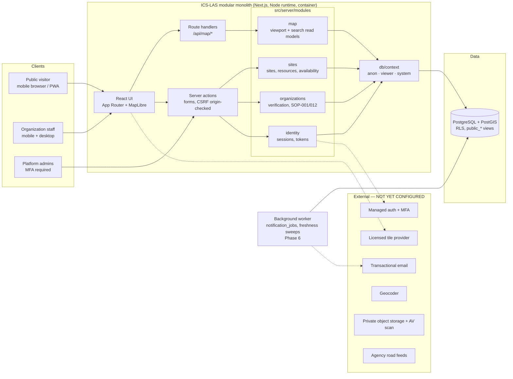

# C. Architecture and Database ERD

## System context



### Key decisions (see `docs/adr/`)

| ADR | Decision |
|---|---|
| 0001 | Modular monolith on Next.js + TypeScript; modules communicate through typed functions, not HTTP. |
| 0002 | PostgreSQL + PostGIS with authorization enforced **in the database** (roles + RLS + public read-model views), and again in services. |
| 0003 | Three DB execution contexts: `anon` (`ics_anon`, views only), `viewer` (`ics_app` + RLS), `system` (trusted server code). |
| 0004 | PGlite (real PostgreSQL 18 + PostGIS 3.6 compiled to WASM) for local dev/tests when Docker is unavailable; production requires `DATABASE_URL`. |
| 0005 | Dev magic-link auth behind an adapter boundary until a managed provider (with MFA) is selected; hard-fails in production. |
| 0006 | Viewport filtering uses planar `geometry &&` on a functional GiST index (map viewports are lat/lng rectangles; geography `&&` is geodesic and over-inclusive — caught by tests). |

### Request authorization path (defense in depth)

1. **UI** hides actions the user can't perform (convenience only).
2. **Service** validates input (zod), checks `ics.can_edit_org()` and returns `FORBIDDEN`/`NOT_FOUND`.
3. **Database role**: anonymous requests run as `ics_anon`, which has `SELECT` only on `public_sites`, `public_resources`, `public_organizations`, `resource_categories`. Base tables are unreadable.
4. **RLS**: authenticated requests run as `ics_app` with a transaction-local `ics.viewer_id`; policies call `SECURITY DEFINER` functions (`can_view_site_row`, `can_view_resource_row`, `can_edit_org`) that are the single source of truth.
5. **Triggers**: resource visibility ≤ site visibility; site tightening cascades; append-only history tables reject `UPDATE`/`DELETE`.
6. **Column privileges**: `organizations.contact_email` and `registration_notes` are not granted to `ics_app`.

## Database ERD (implemented tables; Phase 1–2 slice in bold)

```mermaid
erDiagram
  USERS ||--o{ ORGANIZATION_MEMBERSHIPS : has
  USERS ||--o{ ROLE_ASSIGNMENTS : holds
  USERS ||--o{ SESSIONS : has
  USERS ||--o{ AUTH_TOKENS : has
  ORGANIZATIONS ||--o{ ORGANIZATION_MEMBERSHIPS : has
  ORGANIZATIONS ||--o{ ORGANIZATION_VERIFICATIONS : "decided by"
  ORGANIZATIONS ||--o{ ORGANIZATION_SERVICE_AREAS : serves
  ORGANIZATIONS ||--o{ STAGING_SITES : owns
  STAGING_SITES ||--o{ RESOURCES : holds
  STAGING_SITES ||--o{ SITE_ACCESS_POLICIES : "narrowed by"
  RESOURCES ||--|| RESOURCE_AVAILABILITY : "current state"
  RESOURCES ||--o{ RESOURCE_UPDATE_EVENTS : history
  RESOURCE_CATEGORIES ||--o{ RESOURCES : classifies
  RESOURCE_CATEGORIES ||--o{ FRESHNESS_POLICIES : "review interval"
  ORGANIZATIONS ||--o{ ROAD_INCIDENTS : reports
  ROAD_INCIDENTS ||--o{ ROAD_INCIDENT_EVIDENCE : has
  ROAD_INCIDENTS ||--o{ ROAD_INCIDENT_VERIFICATIONS : has
  ROAD_INCIDENTS ||--o{ ROAD_INCIDENT_EVENTS : history
  ORGANIZATIONS ||--o{ DIRECTORY_ENTRIES : maintains
  DIRECTORY_ENTRIES ||--o{ DIRECTORY_CONTACTS : has
  DIRECTORY_ENTRIES ||--o{ DIRECTORY_VISIBILITY_POLICIES : "shared via"
  DIRECTORY_ENTRIES ||--o{ DIRECTORY_CREDENTIALS : has
  OPERATIONAL_SOP_DEFINITIONS ||--o{ SOP_EXECUTIONS : instantiates

  USERS { uuid id PK; text email UK; text status; timestamptz email_verified_at; timestamptz mfa_enrolled_at; bool is_synthetic }
  ORGANIZATIONS { uuid id PK; text legal_name; text display_name; org_type org_type; org_status status; text contact_email "private"; bool publication_suspended; bool is_synthetic }
  ORGANIZATION_MEMBERSHIPS { uuid id PK; uuid org_id FK; uuid user_id FK; membership_role role; membership_status status }
  ROLE_ASSIGNMENTS { uuid id PK; uuid user_id FK; platform_role role; uuid org_id FK "optional scope"; geography scope_area "MultiPolygon"; timestamptz expires_at; timestamptz revoked_at }
  STAGING_SITES { uuid id PK; uuid org_id FK; visibility_level visibility; geography location "Point, GiST x2"; text city; text county; text postal_code; record_status status; timestamptz last_confirmed_at }
  RESOURCES { uuid id PK; uuid site_id FK; uuid org_id FK; text category_code FK; visibility_level visibility; record_status status }
  RESOURCE_AVAILABILITY { uuid resource_id PK; availability_status availability_status; numeric reported_quantity; quantity_basis quantity_basis; timestamptz last_confirmed_at }
  RESOURCE_UPDATE_EVENTS { uuid id PK; uuid resource_id FK; uuid site_id FK; uuid actor_user_id FK; text event_type; jsonb before_state; jsonb after_state "append-only" }
  FRESHNESS_POLICIES { uuid id PK; text subject_type; text category_code FK; interval interval_normal; interval interval_active_ops }
  AUDIT_LOGS { uuid id PK; uuid actor_user_id FK; text action; text subject_type; uuid subject_id; jsonb details "append-only" }
  NOTIFICATION_JOBS { uuid id PK; text kind; text recipient_email; text status; int attempts }
  SOP_EXECUTIONS { uuid id PK; text sop_code FK; uuid subject_id; text status; timestamptz due_at }
  ROAD_INCIDENTS { uuid id PK; road_report_status status; road_official_status official_status; text official_source_ref; uuid duplicate_of FK; uuid superseded_by FK }
  DIRECTORY_CONTACTS { uuid id PK; uuid entry_id FK; text kind; text value; visibility_level visibility }
```

Also present: `platform_settings` (active-operations flag), `schema_migrations`.

### Read models

| View / function | Audience | Notes |
|---|---|---|
| `public_sites` | `ics_anon`, `ics_app` | PUBLIC + ACTIVE sites of APPROVED, non-suspended orgs. Whitelisted columns. |
| `public_resources` | `ics_anon`, `ics_app` | PUBLIC + ACTIVE resources at public sites, with computed `freshness` and `review_due_at`. |
| `public_organizations` | `ics_anon`, `ics_app` | Approved orgs; no private contact fields. |
| `ics.visible_site_ids_in_bbox()` | `ics_app` | Index prefilter + `can_view_site`; rows re-read under RLS. |

## Deployment topology (target, Phase 7)

Container image (Node 20+, `next start`) × N behind a load balancer/WAF with rate limiting; managed PostgreSQL 16 + PostGIS with PITR; separate worker container; CDN for static assets and the anonymous `/api/map/resources` responses (10 s TTL); structured JSON logs to the platform log sink. Migrations run as a one-off job with the owner role; the app connects with a login role that is a member of `ics_anon`/`ics_app` and is neither owner nor `BYPASSRLS`.
